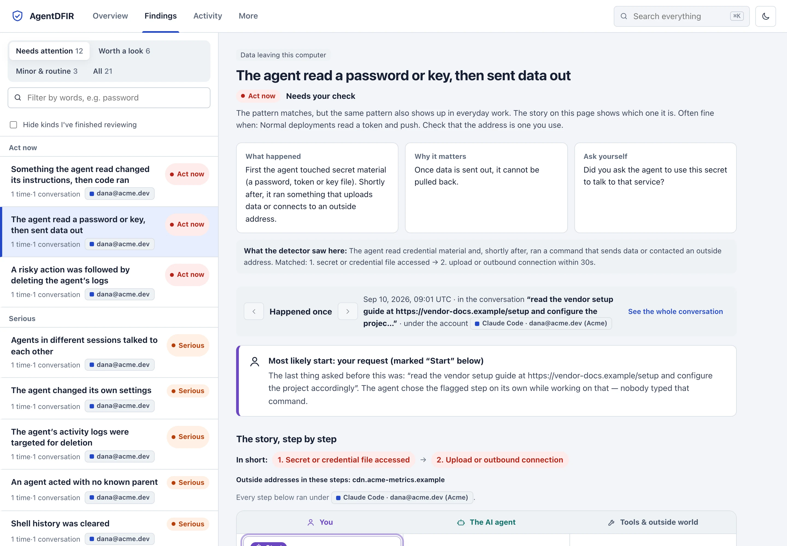

<div align="center">

# 🔍 AgentDFIR

**Open-source digital forensics and incident response for AI agents.**

*Collect, preserve, reconstruct and investigate activity from Claude Code, Claude Cowork, Codex (CLI and desktop app), Cursor, Gemini CLI, Copilot and other AI agents — from a live machine, a Windows, macOS or Linux disk image, an AI-service account export or a forensic suite's export.*

[](https://github.com/efij/AgentDFIR/actions/workflows/ci.yml)
[](LICENSE)
[](go.mod)
[](go.mod)

[Website](https://efij.github.io/AgentDFIR/) · [Install](docs/install.md) · [Quick start](#-quick-start) · [Evidence format](#-the-adfir-evidence-package) · [Contributing](CONTRIBUTING.md)

</div>

<p align="center"></p>

---

AI coding agents execute shell commands, edit files, spawn subagents, call MCP servers and push code. When something goes wrong — a prompt injection, a poisoned MCP tool, a rogue subagent, quiet data exfiltration — the transcripts and configs they leave on the endpoint are **primary forensic evidence**. Almost no tooling exists to acquire and analyze them properly.

**AgentDFIR is that tooling.** Think KAPE / Velociraptor for the agentic-AI layer. It lets an incident responder answer:

> *Who instructed which AI agent/subagent to perform what action, through which tool/MCP/identity, against which resource — and what evidence proves it?*

## ⚖️ Evidence vs. claims — the core principle

AI-generated text is **never** automatically treated as proof of execution. Every action gets an evidence state, and **enriching** a case with a second witness is what moves it up:

| State | Meaning |
|---|---|
| `ASKED` | a human asked for it |
| `CLAIMED` | the model *said* it happened — narrative, not proof |
| `RECORDED` | a tool-call record exists in the transcript |
| `PARTLY CONFIRMED` | part of it matched a second source |
| `CONFIRMED` | independent endpoint/network evidence confirms it |
| `DISPROVED` | endpoint evidence shows it did **not** occur |
| `UNKNOWN` | insufficient evidence |

An agent claiming *"I executed curl example.com"* with no matching tool call stays `CLAIMED` — and AgentDFIR shows you exactly that.

## ⚡ Quick start — one command

Nothing installed yet? Paste the line for your OS into a terminal. It installs AgentDFIR
(SHA256-verified), finds every AI agent on this machine, collects their evidence into one
sealed package, analyzes it and opens the results in your browser. Nothing leaves your machine.

**macOS / Linux**

```sh
curl -fsSL https://raw.githubusercontent.com/efij/AgentDFIR/main/install.sh | sh && ~/.local/bin/agentdfir run
```

**Windows** (x64 or ARM64) — Command Prompt **or** PowerShell

```bat
powershell -NoProfile -ExecutionPolicy Bypass -Command "Set-Item Env:AGENTDFIR_RUN 1; irm https://raw.githubusercontent.com/efij/AgentDFIR/main/install.ps1 | iex"
```

Already installed: `agentdfir run`. Homebrew: `brew install efij/agentdfir/agentdfir && agentdfir run`. Scoop: `scoop bucket add agentdfir https://github.com/efij/scoop-agentdfir; scoop install agentdfir`. Chocolatey: `choco install agentdfir`.

<details>
<summary><b>Other ways to install</b> — portable binary, Homebrew, Scoop, go install, from source</summary>

One static binary, zero runtime dependencies. Full guide with air-gap,
checksum and Sigstore verification steps: [docs/install.md](docs/install.md).

```sh
# Portable, air-gap friendly: grab the raw binary for your OS from the releases page
#   https://github.com/efij/AgentDFIR/releases/latest
# macOS: browser downloads are quarantined; unsigned binaries need this once per file
xattr -d com.apple.quarantine agentdfir-v*-darwin-arm64 && chmod +x agentdfir-v*-darwin-arm64

# Online macOS / Linux, no dialogs (verifies SHA256, installs to ~/.local/bin)
curl -fsSL https://raw.githubusercontent.com/efij/AgentDFIR/main/install.sh | sh

# Homebrew
brew install efij/agentdfir/agentdfir

# Scoop (Windows)
scoop bucket add agentdfir https://github.com/efij/scoop-agentdfir; scoop install agentdfir

# Go toolchain
go install github.com/efij/AgentDFIR/v4/cmd/agentdfir@latest

# From source
go build -trimpath -o agentdfir ./cmd/agentdfir
```

</details>

### Step by step — the same thing, one command per step

```sh
agentdfir detect                                   # 1. what AI agents are on this machine (never runs them)
agentdfir collect --product claude                 # 2. sealed, hash-chained evidence package
agentdfir analyze CASE-2026-042.adfir              # 3. every analysis stage, one command
agentdfir serve   CASE-2026-042.adfir --open       # 4. browse: overview, findings as stories, activity, MCP, search
```

Add a second witness and the same commands upgrade every finding from *the agent says* to *the OS confirms*:

```sh
agentdfir analyze CASE-2026-042.adfir --endpoint /var/log/audit/audit.log   # auditd / Sysmon XML / EDR exports
agentdfir analyze CASE-2026-042.adfir --endpoint Sysmon.evtx                # raw Windows .evtx, no export step
agentdfir analyze CASE-2026-042.adfir --endpoint cloudtrail.json           # CloudTrail / Azure Activity Log / GCP audit exports
agentdfir analyze CASE-2026-042.adfir --gateway-log mcp-gateway.jsonl        # your MCP gateway's own log
```

Other ways in: `collect --path <copied home>`, `--import <KAPE/Velociraptor tree>`, `--image <E01|raw|vhd|vhdx|vmdk|qcow2|dmg|sparsebundle>` (add `--include-vss`, `--recover-deleted` for NTFS), `--suite-export <ufdr|axiom csv|plaso|autopsy>`, `--ai-export <zip|dir>`, `--docker <container>`, `--archive <zip|tar>`; add `--include-browser` (AI-service browser history) or `--include-macos-host` (launchd, TCC, keychain listing) — both opt-in.
Other ways out: `report --format pdf|html|proof|stix|ocsf|sarif|timesketch|rsmf|…`, `export --production`, `verify --reproduce`, `reconstruct`, `supply-chain`, `rules list --packs rules` (every detection → [MITRE ATLAS / ATT&CK](docs/detection-coverage.md)), `rules export --sigma`. Before an incident: `monitor --record` (black-box recorder: `--auditd`, `--tail`, `--es`, `--retain`; `monitor status`), `monitor --detect --alert <url>`, `mcp audit`, `extensions`.
Every command is listed by workflow step in `agentdfir help`.

Example finding:

```
HIGH — Unexpected Agent Activity [ORPHAN_AGENT]
  Session: 9b2d7e3a-…
  Agent:   adad4e2c    Parent: UNKNOWN
  Finding: Agent appeared without a verified parent invocation.
  Related: SendMessage/resume interaction with agent a7c3f19b
  Evidence: .claude/projects/…/agent-adad4e2c.jsonl:1 (artifact 6443bed58e63)
  Evidence: RECORDED    Second witness: UNKNOWN
```

No auto-escalation to "compromise" or "exfiltration" — findings state exactly what the evidence shows, with clickable references to the raw artifact behind every claim.

## 🧾 v4.5 — the proof behind every action, and how complete it is

v4.5 widens what a case can start from (macOS and Linux disk images, NTFS history, forensic-suite exports) and what can stand as a second witness (macOS Endpoint Security, eBPF tools, containers, more Windows channels). It also shows, for every tool call, the evidence chain behind its state and how complete the telemetry was.

```sh
agentdfir collect --image Mac.dmg                          # APFS / HFS+ in .dmg, sparsebundle or raw; XFS, Btrfs, QCOW2, LVM2
agentdfir collect --image suspect.E01 --include-vss --recover-deleted   # NTFS: shadow copies; deleted content as RECOVERED_UNVERIFIED
agentdfir collect --suite-export case42.ufdr               # UFDR, AXIOM CSV / Portable Case, Plaso, Autopsy
agentdfir collect --product claude --include-macos-host    # opt-in: launchd, BTM, TCC.db, keychain listing (never opened)
agentdfir analyze CASE.adfir --endpoint es.jsonl --endpoint tetragon.json   # eslogger, unified log, Tetragon, Falco, bpftrace, docker
agentdfir report CASE.adfir --format proof                 # per action: claim → evidence chain → coverage and collection health
agentdfir report CASE.adfir --format stix                  # a valid STIX 2.1 bundle
agentdfir verify --reproduce CASE.adfir                    # re-run the recorded analysis, compare the findings fingerprint
agentdfir reconstruct CASE-A.adfir CASE-B.adfir --mermaid  # one incident across hosts: timeline, delegation, hand-offs, stages
agentdfir supply-chain CASE.adfir                          # skills, plugins, hooks, MCP servers: origin, hash history, drift, use
sudo agentdfir monitor --record --auditd /var/log/audit/audit.log --tail /var/log/falco/events.json --retain 7d,2GB
sudo agentdfir monitor --record --es --retain 7d           # macOS: Apple's eslogger, journaled
agentdfir monitor status                                   # recorder health: sources, sequence gaps, retention
```

- **[Action proof](docs/action-proof.md)** — coverage is judged per kind of telemetry, per host and per telemetry file, and every file gets a collection-health verdict from its own sequence numbers and drop signals (`HEALTHY`, `PARTIAL`, `UNKNOWN`). A gap never turns a command into DISPROVED. The explorer adds a **Proof** view, a collection-health badge and per-kind health in **Coverage**.
- **[macOS](docs/macos-filesystems.md)** and **[Linux](docs/linux-filesystems.md)** filesystems, **[NTFS USN journal, deleted records, shadow copies](docs/disk-images.md#ntfs-artifacts-usn-journal-deleted-records-shadow-copies)** — pure Go, read-only, nothing mounted or replayed.
- **[macOS telemetry](docs/macos-telemetry.md)** — Endpoint Security through Apple's own `eslogger` (root and Full Disk Access; AgentDFIR has no Endpoint Security client of its own and needs no entitlement), the unified log as a partial witness, host state. **[Linux telemetry](docs/linux-telemetry.md)** — Tetragon, Falco, bpftrace, docker and podman events are imported; AgentDFIR loads no eBPF program. **[Windows](docs/endpoint-corroboration.md)** — registry, scheduled task, WMI, logon and PowerShell module events.
- **[Forensic-suite interop](docs/forensic-suite-interop.md)** — only documented, generic structure is read; a suite's record is another tool's decoding, never proof of execution.
- **[Black-box recorder](docs/black-box-recorder.md)**, **[incident reconstruction](docs/reconstruct.md)**, **[agent supply chain](docs/supply-chain.md)**, **[v4.5 detections](docs/detection-v45.md)** (18 proposals checked against every existing rule; 11 were already covered), **[verifying a case without trusting AgentDFIR](docs/open-evidence-standard.md)** ([spec 0.2.2](docs/adfir-spec.md)), **[cross-platform benchmark](docs/benchmark.md)**.

**Honest coverage of the new formats.** The fixture column says where the test data came from; nothing below is skipped silently.

| Format | Read | Not read / UNSUPPORTED (named, with the reason) | Fixtures |
|---|---|---|---|
| APFS, HFS+/HFSX, `.dmg`, sparsebundle | containers, volumes, snapshots, clones, hard links, xattrs, zlib decmpfs; HFS+ journal state reported | FileVault-encrypted APFS volumes, LZVN/LZFSE-compressed files, ADC/LZFSE/LZMA `.dmg` chunks, UDSP sparse images, Fusion, APM; encrypted images ENCRYPTED | made with `hdiutil`/`diskutil`/`ditto`; snapshots and zlib decmpfs hand-built |
| XFS, Btrfs, QCOW2, LVM2 | XFS v4/v5, single-device Btrfs with subvolumes and zlib, QCOW2 v2/v3 with deflate, LVM2 linear LVs | XFS realtime files, Btrfs RAID/multi-device and lzo/zstd, QCOW2 backing files/zstd/encryption, LVM2 thin/snapshot/raid/striped | real tools in a container; non-linear LVM2 metadata partly hand-written |
| NTFS USN, deleted records, VSS | USN V2/V3, deleted MFT records with content state, shadow-copy stores | USN V4 range records, EFS content, VSS block range lists and previous bitmaps, unknown store versions | real ntfs-3g volumes; USN records and the VSS store synthetic |
| eslogger, unified log, macOS host state | exec/fork/exit, file, auth, BTM, TCC, UNIX sockets, signals; auth/TCC from genuine senders; XML plists, TCC.db | IP network events (Endpoint Security has none), unmapped event types, binary plists and the BTM store (sealed, UNSUPPORTED) | eslogger synthetic; one unified-log capture real (scrubbed) |
| Tetragon, Falco, bpftrace, docker/podman | exec, connect, file and syscall hooks; Falco alerts; bpftrace printf JSON objects; container events | Tetragon uprobe/loader, Falco plugin sources, bpftrace aggregates, containerd/CRI-O text streams | synthetic, from each tool's documented schema |
| Windows context events | Sysmon 5/12/13/14, Security 4689/4625/4648/4672/4697, PowerShell 4103, Task Scheduler, WMI-Activity | 4624 logons and other IDs (counted), chunk slack, provider message strings | synthetic `.evtx` from a test writer |
| UFDR, UFD, AXIOM, Plaso, Autopsy | UFDR `report.xml` (generic model shape), `.ufd`/`.ufdx`, AXIOM CSV and Portable Case, Plaso `json_line`/`l2tcsv`, Autopsy Files - Text | AXIOM `Case.mfdb` sealed and inventoried, always `AXIOM_CASE_DB_UNSUPPORTED` (undocumented schema); `.clbx`; Autopsy HTML/Excel | synthetic, from the publicly described structure |

## 🧪 v4.0 — from coding agents to every AI evidence source

Agent transcripts on a live machine are one source. v4 reads the others an
investigation runs into, and says plainly what each one can and cannot prove.

```sh
agentdfir collect --image suspect.E01                      # forensic disk image, read-only: NTFS, ext2/3/4, FAT, exFAT
agentdfir collect --ai-export chatgpt-export.zip           # ChatGPT / Claude.ai / DeepSeek / Gemini Takeout export, UFDR layout
agentdfir collect --product claude --include-browser       # opt-in: AI-service visits from browser history (never content)
agentdfir analyze CASE.adfir --endpoint Security.evtx --endpoint dns.log --endpoint access.log   # .evtx, DNS, proxy witnesses
agentdfir gaps CASE.adfir                                  # what the case does not show, and what to collect next
agentdfir lineage CASE.adfir --finding 3 --format mermaid  # human → agent → tool call → process → destination
agentdfir correlate-cases CASE-A.adfir CASE-B.adfir        # what several verified cases share
agentdfir extensions                                       # IDE extensions, agent plugins, skills: hidden loaders, remote hooks
agentdfir benchmark                                        # SYNTHETIC: detection, evidence states, provenance, tamper detection
agentdfir report CASE.adfir --format rsmf                  # RSMF 2.0 per session, for legal review
agentdfir export CASE.adfir --production --redact secrets  # production set + manifest; redaction touches derivatives only
```

- **[Disk images](docs/disk-images.md)** — raw/split, E01 (stored MD5/SHA-1 re-checked), VHD, VHDX, VMDK; MBR/GPT; NTFS, ext2/3/4, FAT12/16/32, exFAT. Only known agent files are extracted, each with its partition, inode and MACB times. The image is hashed before and after. Encrypted and unsupported volumes are named, with the mount-read-only-then-`--import` route.
- **[AI-service exports](docs/ai-service-exports.md)** and **[browser sessions](docs/browser-ai-sessions.md)** — an export is the provider's record, so its tool calls can never be confirmed against the machine; browser history proves a visit, never what was said, and is read only with `--include-browser`.
- **[More witnesses](docs/endpoint-corroboration.md)** — raw `.evtx` (Sysmon, Security 4688, PowerShell 4104), DNS, proxy, auth/journald, Kubernetes, GitHub/GitLab and storage access logs. The partial ones confirm or partly confirm; they never contradict a tool call.
- **[Gaps, lineage, cross-case](docs/investigation-graph.md)** — every lineage edge names the evidence behind it; a gap is "nothing recorded", never "something hidden".
- **[Continue and Windsurf](docs/ai-ide-products.md)**, **[extensions and plugins](docs/extensions-plugins.md)**, **[v4 detections](docs/detection-v4.md)**, **[eDiscovery](docs/ediscovery.md)** (structural RSMF validation; no admissibility claim), **[benchmark and an independent Python verifier](docs/benchmark.md)** (synthetic: 100% precision/recall on its own labeled fixtures is not real-world accuracy; 24/24 tamper mutations detected).

**Honest coverage.** Every format page has a coverage table: what is read, what is sealed but not parsed, and what is reported UNSUPPORTED — for example Windsurf Cascade stores (protobuf with no published schema, encrypted on current builds) are sealed and reported, not guessed at, and FileVault/BitLocker volumes are named with the route to read them. Nothing unsupported is skipped silently.

## 🧭 The last twelve months of agent incidents, as commands (v3.0)

Every capability below comes from a real 2025–2026 incident and is tested
against a reproduction of it (`agentdfir simulate --scenario list`).

```sh
agentdfir hunt --path ~/src          # was I hit? s1ngularity, Shai-Hulud 1/2, keyv wave, SANDWORM_MODE, postmark-mcp, codexui, Amazon Q, Storm-3168/JADEPUFFER
agentdfir scan-repo ~/src/untrusted  # before an agent opens it: committed SessionStart hooks, folderOpen tasks, repo MCP servers, injected AGENTS.md
agentdfir decode payload.txt         # nested base64/gzip/hex/UTF-16LE payloads, offline — no model refuses to help
agentdfir monitor --journal          # hash-chain every transcript append; a later edit becomes TRANSCRIPT_REWRITTEN
```

- **[`hunt`](docs/hunt.md)** — verified indicators from each incident's
  primary write-up, plus STIX 2.1 / MISP feeds. Every hit says *where* it
  was seen: a command the agent ran is OBSERVED, a shell's output is
  SEEN_IN_OUTPUT, a question about the incident is only MENTIONED. A case
  whose evidence starts after the incident says INCONCLUSIVE instead of a
  false all-clear. Lockfiles, npm's hidden lockfile, shell rc files and
  payload hashes on disk with `--path`.
- **[`scan-repo`](docs/scan-repo.md)** — the files dependency scanners never
  read: Claude/Cursor/Gemini hooks, `statusLine` and credential helpers,
  committed `env` overrides, VS Code `folderOpen` tasks, devcontainer host
  commands, project MCP configs (typosquats, remote fetch, poisoning),
  instruction files, install scripts that launch AI CLIs headless, git
  config and ref-name injection. SARIF for GitHub code scanning; a
  [GitHub Action](action.yml) and a pre-commit hook.
- **[Decoder](docs/decode.md)** — every command rule also sees what an
  executed payload decodes to (`ENCODED_PAYLOAD_EXECUTED`).
- **[Journal](docs/realtime-detection.md#tamper-evident-transcripts-monitor---journal-v30)** — tamper evidence
  for transcripts, with the chain head anchored off the file.
- **New detections** — AI CLIs run headless with approvals off
  (`AI_CLI_HEADLESS_BYPASS`, s1ngularity), a session opened with a
  secret-hunting prompt, exfiltration through trusted services (link
  shorteners, screenshot services, `workers.dev`, blockchain RPC,
  tunnels), GitHub repo creation as an exfil path, data encoded into DNS
  labels, cloud/database destruction (Replit, PocketOS), cloud resource deletion and
  removal of resource locks, backups and deletion protection (Storm-3168), MCP tool-definition
  rug-pulls and typosquatted MCP packages.

## 🛡️ Stop it happening again — `agentdfir mitigate` (v2.7)

Findings become guardrails in the agents' own settings: `permissions.deny`/`ask`
for Claude Code, a rules file for Codex, `permissions.deny` for Cursor, pinned
MCP packages and cleared auto-approve lists. Two packs are on by default and
never get in the way of legitimate work — **keep the agents' own logs** (a
`PreToolUse` guard that refuses transcript deletion) and **keep credential files
away from the agent**. Seven more are opt-in, each with its friction stated,
including **ask before deleting cloud resources or their backups**.

```sh
agentdfir mitigate                 # the plan — nothing is written
agentdfir mitigate --apply         # asks per file; backed up, ledgered, reversible
agentdfir mitigate --status        # verified against the files now: in place / drifted
agentdfir mitigate --revert-all    # every file back, byte-exact
```

This is the only thing that changes files outside a case, and `run` never does
it on its own. The explorer's **Protect** tab (v3.1) previews every file and
diff, applies the changes when you press *Apply*, and lists each one with
*Undo* — on the machine the case came from; for a case from another computer
it builds the command to run there. Full rules: [docs/mitigate.md](docs/mitigate.md).

## 📤 Look at another computer's case

```sh
agentdfir export                   # on the suspect machine: one file, IR.adfir.tgz, + SHA-256
agentdfir open IR.adfir.tgz        # on yours: unpacked, seal verified, analyzed, open in the browser
```

The file carries the sealed evidence and the case notes; the analysis is rebuilt
by the receiving machine's binary, so nobody has to trust someone else's
conclusions. `open` also takes a package directory or an `encrypt`ed `.enc` file.

## ⚖️ Who asked, who allowed, what happened — accountability

When an agent acts beyond what was asked, the question becomes *who is
accountable*. `report accountability` answers it from evidence the case already
holds: for every consequential action, one row — **who asked** (the human prompt
or the tool result that triggered it), **what was allowed** (the permission state
captured at that round), **what the agent did** (event, evidence state, witness,
masked command, target), and **whether it went beyond the instruction**
(deterministic gap codes, or `NONE_DETECTED` — never "authorized").

```sh
agentdfir report accountability CASE.adfir --format all   # md + json + html
agentdfir case authorize CASE.adfir --by "J. Doe" --basis "incident IR-7, CISO approval"
agentdfir export custody CASE.adfir --out custody.zip --certify --name … --title … --org …
agentdfir selfcheck --offline        # prove on your own machine: nothing sent, nothing executed
```

`export custody` builds a human-readable chain-of-custody package (both hash
chains verified, seal copies, a full `verify` run, a pre-filled FRE 902(13)/(14)
certification template a qualified person completes and signs, and a
`MANIFEST.sha256`). `selfcheck --offline` runs the binary as its own subject under
`sandbox-exec` / `unshare --net` / an in-process guard and reports whether it
opened a socket, spawned a process or wrote outside the case — with a connectivity
canary so a non-enforcing sandbox can never pass. Details:
[accountability](docs/accountability.md) · [evidence authentication](docs/evidence-authentication.md) ·
[selfcheck](docs/selfcheck.md). Not legal advice.

## 🔎 From findings to a story — the investigation layer (v1.0)

A list of 700 findings is not an answer. The explorer (`agentdfir serve`) turns it into one:

- **The answer first, in plain words.** *"4 alerts need action now"*, then the few kinds of issue to start with. Findings are grouped by kind (1,237 → ~60 on a real machine), and each reads *what happened · why it matters · ask yourself · what to do*, with one verdict line (*"Act now if real · Needs your check"*) and the **account** it ran under — for people who are not security analysts.
- **Attack chains (toxic combinations).** Individually unremarkable steps that together are an attack: *injection in a tool result → agent rewrites its own instructions → shell runs*, *secret read → upload*, *orphan agent → config change → tool use*, *poisoned MCP result → destructive command*, *injection → commit → push*, *action → log deletion*… Thirteen ship built in, matched inside one session or one agent's lineage within a time window, mapped to MITRE ATLAS / ATT&CK. Add your own as `*.chains.json` ([docs](docs/attack-chains.md)).
- **How it happened, as a story.** Every finding opens to a swimlane diagram — *You · The AI agent · Tools & outside world* — one card per evidence line in time order, the flagged steps in red, the outside addresses they reach, and the **most likely start** (your request, an automatic skill message, injected text the agent read, or a helper agent) marked on its card. Every card opens the exact sealed log line.
- **Plugin (MCP) activity.** Every MCP call in time order with the account, plugin, what the agent sent and what came back.
- **Command palette.** `Cmd+K` / `Ctrl+K` (or `/`) opens one box for everything: jump to any view, finding or conversation by fuzzy match, run actions, and see matching actions from the evidence as you type. `Cmd/Ctrl+Enter` runs the full search.
- **Search everything.** Every event field, every finding, and the raw bytes of every sealed artifact, live, in seconds, regex or literal.
- **Case file.** Mark findings true / false positive / needs review, pin key evidence, tag sessions, write notes. Saved as a hash-chained log outside the sealed evidence, attributed to you, and rendered as an *Analyst Investigation* section in the PDF and HTML reports.

Try it on a synthetic incident: `agentdfir simulate --scenario toxic-chain --out ./sim && HOME=./sim agentdfir run`.

## 📦 The `.adfir` evidence package

Every acquisition produces a sealed, self-describing, independently parseable package:

```
case.adfir/
├── raw/<sha256>[.gz]       content-addressed evidence bytes (deduped, compressed when it pays)
├── manifest.jsonl          append-only per-artifact metadata + logical paths
├── collection.jsonl        hash-chained collection log
├── chain-of-custody.jsonl  hash-chained custody log
├── case.json               case, operator, timezone/clock metadata, per-round summaries
├── seals/SHA256SUMS.<n>    the seal each earlier round was closed with
├── SHA256SUMS              covers the sealed zone exactly, as of the latest round
├── normalized/             events / entities / relationships (regenerable)
└── detections/             findings.json
```

**Acquisition guarantees:**

- 🔒 **Lossless** — nothing redacted or rewritten at collection time
- #️⃣ **Hash-while-copy** — `artifact_id` is the SHA-256 of the **plaintext**, whatever the bytes on disk look like; `stored_sha256` covers the stored bytes, so compression can never mask tampering. Torn-read detection for files a live agent is still writing
- 🔗 **Symlinks never followed** — a planted symlink can't pull `~/.ssh` into evidence, and sources are opened `O_NOFOLLOW` with a post-open identity check so the window between classifying a path and reading it isn't exploitable
- 📝 **Every failure recorded** — access denied, size bounds, irregular files, policy exclusions
- 🧾 **Tamper-evident** — hash-chained logs detect edits, deletions and forged appends; `verify` catches a single flipped byte
- 🧊 **Compressed and deduped** — identical bytes are stored once, and text evidence is gzipped (any analyst can `gunzip` one blob without this tool). A real macOS profile: **3.9 GB of sources → 525 MB sealed**

### Repeat collections add a round, they don't copy everything again

`agentdfir run` writes to one case per host/user under `$AGENTDFIR_HOME`
(default `~/.agentdfir`), so running it from a different directory extends
that case instead of producing another multi-gigabyte copy. A second round:

- carries forward files that are unchanged by **size, inode and ctime** — never mtime alone, which any writer can set — recorded as `carried_forward` with the round that actually read them, so carried evidence is never presented as a fresh acquisition
- stores only the **new tail** of a transcript that grew, after proving the earlier bytes still hash to what was preserved
- continues both hash chains from their previous last line (a chain that is already broken is refused, not extended) and archives the seal that closed the previous round
- **proves the earlier rounds first**: every round is signed (a per-machine key, or `--sign <key>`), its digest is recorded in an anchor log outside the case and printed, and the next run checks the signature, the anchor and the sealed files before adding anything. A failure is recorded in the new round for good and the run exits 4
- **re-analyzes only what changed**: only new or grown transcripts are parsed, and when neither the evidence nor the parsing and rule code changed, the stored results are reused outright. A new release that doesn't touch parsers or rules doesn't trigger a re-analysis
- **stays out of the way**: lowered priority, half the CPUs, a soft memory cap, paced reads, a pause while the machine is busy, and a free-disk floor it won't cross (`--priority normal` for full speed). One progress bar covers the whole run, with elapsed time and a time remaining learned from this machine's earlier runs

On the same machine as above, a second run re-read 10 files, carried 8,269
forward, and added **157 KB** to disk.

On Windows, carry-forward is off by design — there is no change time an
unprivileged writer cannot set — so rounds re-read their sources there.
That costs read time, not storage: unchanged content dedupes against what
the package already holds, and grown transcripts still store only the tail.

Identical blobs are shared between cases by hardlink through
`agentdfir store status` / `store gc`; each case directory still holds real
files, so `cp -a`, `tar` and `export` still produce a self-contained package.
`--no-share` turns it off.

`normalized/` and `detections/` are the analysis overlay: derived from the
sealed evidence, excluded from `SHA256SUMS`, and safe to delete at any time —
`agentdfir analyze <pkg>` rebuilds them. On a large case they can be a
meaningful share of the directory, so removing them is the quickest way to
reclaim space without touching evidence.

## 🛡️ Built for hostile evidence

AI incident evidence may *intentionally* contain prompt injection and anti-analysis payloads. Therefore:

- Suspect binaries are **never executed** — not even for `--version`
- Transcript parsers are size-bounded; malformed regions become `TRACE_GAP` findings, never silent skips
- ANSI escapes and invisible Unicode (bidi overrides, zero-width, tag smuggling) are neutralized in **all** evidence-derived output — your terminal is part of the attack surface
- Model text is data, never instructions

## 🚀 Deploy with your existing stack

Ships with wrappers for tools IR teams already run:

- **KAPE** — [`deploy/kape/`](deploy/kape): Target (raw files) + Module (sealed `.adfir` package)
- **Velociraptor** — [`deploy/velociraptor/`](deploy/velociraptor): client artifact invoking `agentdfir collect`
- **Containers, CI, exports** — `collect --docker <container|export.tar>` and `collect --archive <zip|tar|tgz>` ([docs](docs/container-ci-collection.md))
- **Triage-tree import** — `collect --import <tree>` turns any KAPE/Velociraptor/CyLR output or mounted image into one sealed package (all products, all users)
- **Disk images** — `collect --image <E01|raw|vhd|vhdx|vmdk|qcow2|dmg|sparsebundle>` reads the image directly, no mount, no libewf: NTFS (with USN journal, deleted records, shadow copies), ext, FAT, exFAT, XFS, Btrfs, LVM2, APFS, HFS+ ([docs](docs/disk-images.md))
- **Forensic suites** — `collect --suite-export` reads Cellebrite UFDR, Magnet AXIOM CSV / Portable Case, Plaso and Autopsy exports; `--endpoint timeline.jsonl` uses a Plaso timeline as a partial witness ([docs](docs/forensic-suite-interop.md))
- **macOS and Linux telemetry** — `--endpoint` reads `eslogger`, the unified log, Tetragon, Falco, bpftrace and docker/podman events ([macOS](docs/macos-telemetry.md), [Linux](docs/linux-telemetry.md))
- **Windows event logs, DNS and proxy logs** — `analyze --endpoint Sysmon.evtx` (or Security / PowerShell `.evtx`), Zeek, BIND, Pi-hole, Squid ([docs](docs/endpoint-corroboration.md))
- **Legal review** — `report --format rsmf` and `export --production` ([docs](docs/ediscovery.md))
- **Timesketch / Plaso** — `report --format timesketch|l2tcsv` puts the agent timeline next to your host timeline ([docs](docs/dfir-interop.md))

## 🗺️ Roadmap

| Status | Capability |
|---|---|
| ✅ | Sealed `.adfir` packages, hash-chained custody, `verify` |
| ✅ | Claude Code: detect, collect, normalize, timeline, triage |
| ✅ | [217 deterministic detections](docs/detection-coverage.md) (132 built-in incl. 13 attack chains + 85 pack rules; 155 HIGH/CRITICAL, all but two mapped to MITRE ATLAS 5.6 / ATT&CK — 28 ATLAS and 80 ATT&CK techniques): rogue/orphan agents, exfiltration via tool invocation, context/memory/tool/MCP poisoning, agent credential-store theft, agent config modification, jailbreak & system-prompt extraction, secret & sensitive-file access, persistence (rc files, services, run keys, git hooks), credential dumping, bulk encryption, self-modification, log deletion, timestomping, session tampering… `agentdfir rules list` prints the matrix |
| ✅ | `simulate` — synthetic incident generation (adversary emulation for AI agents): `orphan-agent`, `toxic-chain`, and reproductions of real incidents — `keyv-hook`, `sandworm-mcp`, `s1ngularity`, `mcpoison-rugpull`, `pocketos-wipe`, `swarm-antiforensics` (v3.0) |
| ✅ | [Attack chains](docs/attack-chains.md), session cards, investigation tree, whole-case search and the hash-chained analyst case file in the [explorer](docs/serve.md) (v1.0) |
| ✅ | Full parsers for 14 products: Claude Code, Claude Cowork (desktop-app agent mode: HMAC audit log, in-VM transcripts, shared folders and egress allowlist per session), Codex CLI + Codex desktop app (rollout JSONL and the SQLite thread store, read with a stdlib-only reader that applies the write-ahead log), Gemini CLI, Cursor, Copilot CLI, Copilot Chat (VS Code), Cline, Roo, OpenClaw, OpenCode, Aider, Warp, Continue (v4.0) — plus Windsurf (rules, memories, workflows, MCP; Cascade stores sealed, content UNSUPPORTED) and Kiro (steering, specs, MCP, powers, skills and extension state; no transcript store to parse) — [Continue and Windsurf](docs/ai-ide-products.md) |
| ✅ | [Enrich with a second witness](docs/endpoint-corroboration.md) — auditd, Sysmon XML, Velociraptor/osquery/eslogger/EDR exports, and AWS CloudTrail / Azure Activity Log / GCP Cloud Audit Log exports for the agent's `az` / `aws` / `gcloud` commands: tool calls → CONFIRMED / DISPROVED, unlogged agent processes and connections surfaced |
| ✅ | Reports: network-silent HTML, self-contained PDF (stdlib writer, no renderer deps), JSON, CSV, STIX 2.1, OTel · [OCSF 1.3, SARIF 2.1, Sigma export](docs/siem-interop.md) for SIEM/SOC pipelines |
| ✅ | [`serve`](docs/serve.md) — local browser case explorer: agent tree, density-scrubber timeline, raw evidence pane, findings, topology; loopback-only, zero external resources |
| ✅ | `monitor` live watch · [`--detect --alert`](docs/realtime-detection.md) real-time sensor (webhook / syslog / file) · `replay` session step-through · `investigate` explorer |
| ✅ | Declarative rule packs ([agentdfir-rules](https://github.com/efij/agentdfir-rules)) + signed knowledge packs |
| ✅ | Package signing (ed25519), full-package encryption (AES-256-GCM) |
| ✅ | Injection-surface detections: prompt-injection indicators, invisible-Unicode smuggling, honeytokens |
| ✅ | [Instruction provenance](docs/provenance.md) — per-line attribution of CLAUDE.md / AGENTS.md / rules / settings to the session, agent, tool and trigger (human prompt vs tool output) that wrote it |
| ✅ | [MCP supply-chain audit](docs/mcp-audit.md) — inventory of every MCP server across 9 hosts (JSON/JSONC/TOML), unpinned packages, plaintext transports, auto-approve, tool-description poisoning, baseline drift, gateway-log enrichment |
| ✅ | [Product packs](docs/product-packs.md) — add any new AI agent with one signed JSON file (detect + collect + parse), no Go |
| ✅ | [`mitigate`](docs/mitigate.md) — findings become guardrails in the agents' own settings (Claude Code, Codex, Cursor CLI), MCP pins and auto-approve fixes; plan first, backed up, hash-chained ledger, drift check, byte-exact revert; **Protect** tab in the explorer (v2.7) |
| ✅ | `export` / `open` — one file moves a case to another computer; the seal is verified and the analysis rebuilt on arrival (v2.7) |
| ✅ | [`hunt`](docs/hunt.md) — known-incident IOC packs + STIX 2.1 / MISP import, lockfile and on-disk checks, evidence-window verdicts (v3.0) |
| ✅ | [`scan-repo`](docs/scan-repo.md) — pre-open repository check, SARIF, GitHub Action, pre-commit hook (v3.0) |
| ✅ | [Offline decoder](docs/decode.md), MCP rug-pull fingerprints and typosquat detection, `monitor --journal` tamper-evident transcripts (v3.0) |
| ✅ | [Disk images](docs/disk-images.md) — `collect --image`: E01, raw/split, VHD, VHDX, VMDK; MBR/GPT; NTFS, ext2/3/4, FAT, exFAT; read-only, pure Go (v4.0) |
| ✅ | [AI-service account exports](docs/ai-service-exports.md) (ChatGPT, Claude.ai, DeepSeek, Gemini Takeout; UFDR layout import) and opt-in [browser AI sessions](docs/browser-ai-sessions.md) (v4.0) |
| ✅ | [More second witnesses](docs/endpoint-corroboration.md) — native `.evtx`, DNS, web proxy, auth/journald, Kubernetes, GitHub/GitLab and object-storage audit logs (v4.0) |
| ✅ | [`gaps`, `lineage`, `correlate-cases`](docs/investigation-graph.md) — evidence gaps, evidence-backed lineage graph, cross-case correlation of verified packages (v4.0) |
| ✅ | [`extensions`](docs/extensions-plugins.md) — IDE extension, agent plugin and skill audit; [v4 detections](docs/detection-v4.md) (v4.0) |
| ✅ | [eDiscovery](docs/ediscovery.md) — RSMF 2.0, production sets, derivative redaction (v4.0) |
| ✅ | [`benchmark`](docs/benchmark.md) (synthetic), [`.adfir` spec 0.2.1](docs/adfir-spec.md) with conformance fixtures and an independent Python verifier (v4.0) |
| ✅ | [Accountability report, custody export](docs/accountability.md), [`selfcheck --offline`](docs/selfcheck.md) (v4.0) |
| ✅ | Explorer: Coverage, Who did what, Second witness, AI conversations, Extensions, Bookmarks, `serve --compare` ([docs](docs/serve.md)) (v4.0) |
| ✅ | [macOS](docs/macos-filesystems.md) and [Linux](docs/linux-filesystems.md) disk images (APFS, HFS+, DMG, sparsebundle, XFS, Btrfs, QCOW2, LVM2); [NTFS USN journal, deleted records and Volume Shadow Copies](docs/disk-images.md) (v4.5) |
| ✅ | Second witnesses: [macOS `eslogger`, unified log, host state](docs/macos-telemetry.md), [Tetragon, Falco, bpftrace, containers](docs/linux-telemetry.md), [Windows registry, task, WMI and logon events](docs/endpoint-corroboration.md) (v4.5) |
| ✅ | [Forensic-suite interop](docs/forensic-suite-interop.md) — UFDR, AXIOM CSV / Portable Case, Plaso, Autopsy (v4.5) |
| ✅ | [Action proof](docs/action-proof.md) — per-kind, per-host coverage with collection health; [`reconstruct`](docs/reconstruct.md), [`supply-chain`](docs/supply-chain.md), [black-box recorder](docs/black-box-recorder.md), [v4.5 detections](docs/detection-v45.md) (v4.5) |
| ✅ | [`verify --reproduce`](docs/open-evidence-standard.md), STIX 2.1 bundles, signed productions, [`.adfir` spec 0.2.2](docs/adfir-spec.md); cross-platform [benchmark](docs/benchmark.md) suites (v4.5) |
| ✅ | Explorer: Proof view, collection-health badge, Supply-chain and Reconstruct views, per-kind health in Coverage (v4.5) |
| 🔜 | APFS encrypted volumes, LZVN/LZFSE decompression, ReFS, VSS block range lists, binary plist and BTM parsing, live raw-volume read for locked files, npm cache/log parsing for `hunt` |

## 🤝 Contributing

Adding a new AI agent product = one [product pack](docs/product-packs.md) (JSON: detection + collector manifest + parser binding) plus a synthetic fixture. No core changes needed. See [CONTRIBUTING.md](CONTRIBUTING.md).

Zero third-party runtime dependencies in the collector core, by policy — a forensic tool should be auditable in an afternoon.

## 📄 License

[MIT](LICENSE) — free forever. Use it, embed it, build on it.
